# Hi, I'm TypeGuja 👋

> **Language:** [Русский](README.md) · English

I write all kinds of things in **Rust**: my own 3D engine with RTX, firmware for hardware, pony animation and game mods.

## 📊 Stats

  
  

  
  

  

The cards update every 6 hours via GitHub Actions. Languages are counted by code size in my public repositories (forks and decompiled code excluded).

## 🗂️ Projects

<b>Engines and graphics</b>

 

| Project | Description |
|---|---|
| **[AlKAsH3D-Engine](https://github.com/TypeGuja/AlKAsH3D-Engine)** | Engine for creating 3D RTX games in Rust (+Python) |
| **[site-AlKAsH3D-](https://github.com/TypeGuja/site-AlKAsH3D-)** | Website of the AlKAsH3D engine: HTML/JS + PHP API with an admin panel |
| **[TenzaX32](https://github.com/TypeGuja/TenzaX32)** | MLP-style 2D pony animation engine: skeleton, parts and morphs instead of thousands of frames |
| **[Python-Hardware-Accelerator](https://github.com/TypeGuja/Python-Hardware-Accelerator)** | Rust module for Python (PyO3 + Rayon): parallel computing from Python |

<b>Firmware and hardware</b>

 

| Project | Description |
|---|---|
| **[OSI-X](https://github.com/TypeGuja/OSI-X)** | Modular firmware for a homemade ESP32-S3 3D printer (Rust, ESP-IDF) |

<b>Games and mods</b>

 

| Project | Description |
|---|---|
| **[Garry-s-mod-RustCore](https://github.com/TypeGuja/Garry-s-mod-RustCore)** | Native Rust module: accelerator and visual tuner for Garry's Mod (Metrostroi) |
| **[ModularWarfare-1.20.1](https://github.com/TypeGuja/ModularWarfare-1.20.1-CROSSBATTLEv0.6-1.20.1)** | Two updated mods for Minecraft 1.20.1 |
| **[Desktop-ponies-2-](https://github.com/TypeGuja/Desktop-ponies-2-)** | Desktop Ponies rewritten in Rust |

<b>Utilities and tools</b>

 

| Project | Description |
|---|---|
| **[claude-animate](https://github.com/TypeGuja/claude-animate)** | Claude Code plugin for Adobe Animate via JSFL: symbols, layers, frames, rendering |
| **[DiscordCommandAutoSender](https://github.com/TypeGuja/DiscordCommandAutoSender)** | Sends commands to Discord automatically for the ASTERISM server |
| **[wallpaper---winproc](https://github.com/TypeGuja/wallpaper---winproc)** | Animated character living on the Windows desktop over the wallpaper (Rust) |

<b>Reverse engineering</b>

 

| Project | Description |
|---|---|
| **[MAX-Messenger-](https://github.com/TypeGuja/MAX-Messenger-)** | Decompiled source of the MAX messenger (.dex → Java) |

