# Привет, я TypeGuja 👋

> **Язык:** Русский · [English](README.en.md)

Пишу на **Rust** всё подряд: свой 3D-движок с RTX, прошивки для железа, анимацию пони и моды для игр.

## 📊 Статистика

  
  

  
  

  

Карточки сами обновляются каждые 6 часов через GitHub Actions. Языки считаются по объёму кода в моих публичных репозиториях (без форков и декомпилированного кода).

## 🗂️ Проекты

<b>Движки и графика</b>

 

| Проект | Описание |
|---|---|
| **[AlKAsH3D-Engine](https://github.com/TypeGuja/AlKAsH3D-Engine)** | Движок для создания 3D-игр с RTX на Rust (+Python) |
| **[site-AlKAsH3D-](https://github.com/TypeGuja/site-AlKAsH3D-)** | Сайт движка AlKAsH3D: HTML/JS + PHP API с админкой |
| **[TenzaX32](https://github.com/TypeGuja/TenzaX32)** | Движок 2D-анимации пони в стиле MLP: скелет, части и морфы вместо тысяч кадров |
| **[Python-Hardware-Accelerator](https://github.com/TypeGuja/Python-Hardware-Accelerator)** | Rust-модуль для Python (PyO3 + Rayon): параллельные вычисления из Python |

<b>Прошивки и железо</b>

 

| Проект | Описание |
|---|---|
| **[OSI-X](https://github.com/TypeGuja/OSI-X)** | Модульная прошивка самодельного 3D-принтера на ESP32-S3 (Rust, ESP-IDF) |

<b>Игры и моды</b>

 

| Проект | Описание |
|---|---|
| **[Garry-s-mod-RustCore](https://github.com/TypeGuja/Garry-s-mod-RustCore)** | Нативный Rust-модуль: ускоритель и визуальный тюнер для Garry's Mod (Metrostroi) |
| **[ModularWarfare-1.20.1](https://github.com/TypeGuja/ModularWarfare-1.20.1-CROSSBATTLEv0.6-1.20.1)** | Два обновлённых мода для Minecraft 1.20.1 |
| **[Desktop-ponies-2-](https://github.com/TypeGuja/Desktop-ponies-2-)** | Desktop Ponies, переписанные на Rust |

<b>Утилиты и инструменты</b>

 

| Проект | Описание |
|---|---|
| **[claude-animate](https://github.com/TypeGuja/claude-animate)** | Плагин Claude Code: работа в Adobe Animate через JSFL — символы, слои, кадры, отрисовка |
| **[DiscordCommandAutoSender](https://github.com/TypeGuja/DiscordCommandAutoSender)** | Автоматическая отправка команд в Discord для сервера ASTERISM |
| **[wallpaper---winproc](https://github.com/TypeGuja/wallpaper---winproc)** | Анимированный персонаж на рабочем столе Windows поверх обоев (Rust) |

<b>Реверс</b>

 

| Проект | Описание |
|---|---|
| **[MAX-Messenger-](https://github.com/TypeGuja/MAX-Messenger-)** | Декомпилированный код мессенджера MAX (.dex → Java) |

